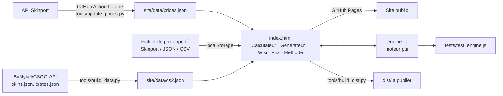
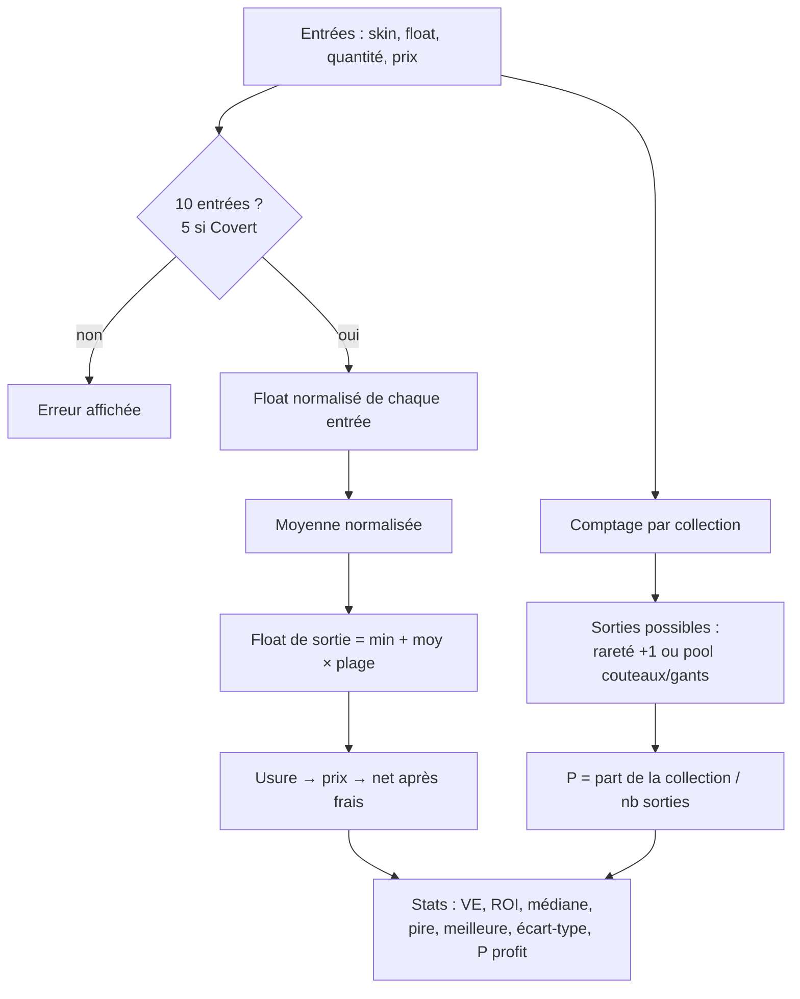
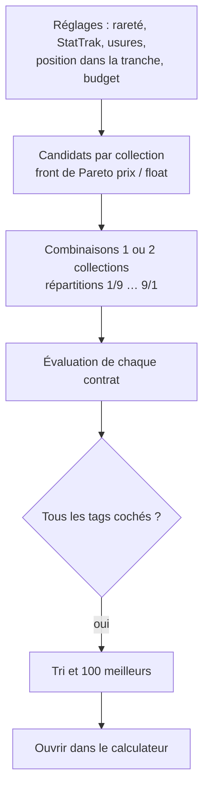

# SCHEMA — architecture et flux de calcul

_Révision : 2026-11-25_

## Sommaire
1. [Architecture](#architecture)
2. [Calcul d'un contrat](#calcul-dun-contrat)
3. [Générateur](#générateur)

## Architecture

## Calcul d'un contrat

## Générateur

